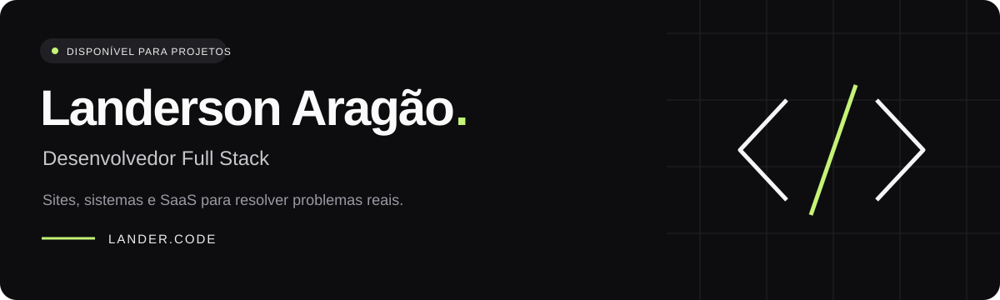
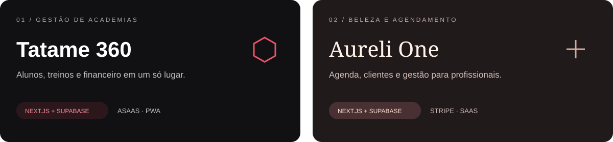

  

  
  
  

  <strong>Da ideia à aplicação: interface, dados, integrações e entrega.</strong> 
  Desenvolvimento web com foco em negócios, experiência no celular e problemas reais.

---

## 👨🏾‍💻 Quem está por trás do código

Sou **Landerson Aragão**, desenvolvedor Full Stack e estudante de **Gestão da Tecnologia da Informação na FADBA**, em Cachoeira–BA.

Construo **sites, sistemas de gestão e produtos SaaS**, trabalhando desde os fluxos e a interface até autenticação, banco de dados e pagamentos. Minha base em suporte técnico, redes e cibersegurança contribui para o cuidado com segurança e manutenção das aplicações.

- 🛠️ **Na prática:** Next.js, React, TypeScript e Supabase.
- 🚀 **Construindo:** Tatame 360, Aureli One e soluções para o PET Saúde.
- 🤖 **IA no trabalho:** planejamento, prototipação, implementação e revisão.
- 🤝 **Aberto a:** projetos freelance e oportunidades Front-end / Full Stack.

## ⚡ Minha stack

  

  
  
  
  
  

## 🧩 Produtos que estou construindo

### 🥋 Tatame 360

**Gestão para academias de artes marciais e professores independentes.**

Alunos, planos, mensalidades, fluxo de caixa, turmas e presença em uma aplicação pensada para a rotina no tatame. Inclui permissões por função, isolamento de dados por academia, cobranças com **Asaas** e instalação como **PWA**.

`Next.js` `React` `TypeScript` `Supabase` `PostgreSQL` `Asaas`

**[Conhecer o Tatame 360 ↗](https://tatame360.landeraragao.com.br)**

### ✂️ Aureli One

**Agendamento e gestão para salões, barbearias e profissionais de beleza.**

Agenda com controle de disponibilidade, prevenção de sobreposição de horários, clientes, serviços e profissionais. Assinaturas com **Stripe**, webhooks, limites por plano e organização dos dados por estabelecimento.

`Next.js` `React` `TypeScript` `Supabase` `PostgreSQL` `Stripe`

### 🏥 Sistema PET Saúde

Gestão de pacientes, atendimentos, triagem, fluxo operacional e relatórios, desenvolvida no contexto do PET Saúde.

### ⏱️ Folha de Ponto Digital

Registro de jornada, acompanhamento de horas, histórico e exportação de dados. Acesso por diferentes perfis de usuário e instalação como PWA.

**[Ver mais trabalhos no portfólio ↗](https://landeraragao.com.br)**

## 🔧 O que desenvolvo na prática

| | Experiência |
| :---: | --- |
| 🎨 | **Interfaces:** aplicações responsivas, componentes reutilizáveis e experiência mobile-first. |
| 🔐 | **Autenticação e acesso:** Supabase Auth, permissões por função e políticas RLS. |
| 🗃️ | **Dados:** modelagem relacional em PostgreSQL e isolamento entre organizações. |
| 💳 | **Pagamentos:** Stripe e Asaas, assinaturas, webhooks e regras por plano. |
| 📦 | **Entrega:** Git, testes automatizados, publicação na Vercel e aplicações PWA. |

## 🤖 IA aplicada ao desenvolvimento

Uso **Codex, Claude e Gemini** para estruturar soluções, explorar interfaces, implementar funcionalidades e investigar problemas.

Minha experiência inclui **engenharia de prompts, organização do contexto e divisão de entregas em etapas verificáveis**, com revisão do código, testes de fluxos e validação das regras de negócio.

---

  <strong>Tem um projeto em mente ou uma oportunidade em desenvolvimento?</strong> 
  Vamos conversar sobre como posso contribuir.

  <a href="https://landeraragao.com.br"><strong>🌐 Conheça meu trabalho</strong></a>
  &nbsp; · &nbsp;
  <a href="https://www.linkedin.com/in/landerson-aragao/"><strong>💬 Fale comigo no LinkedIn</strong></a>

